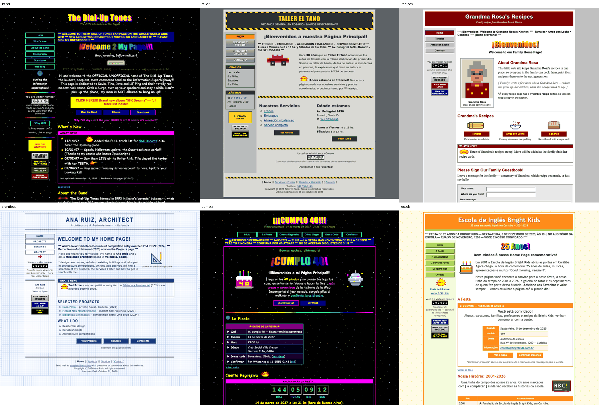
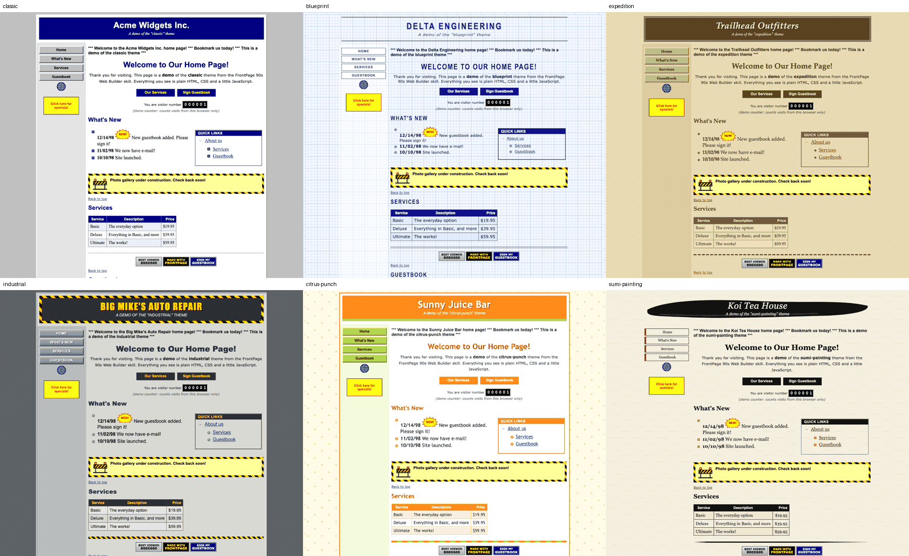
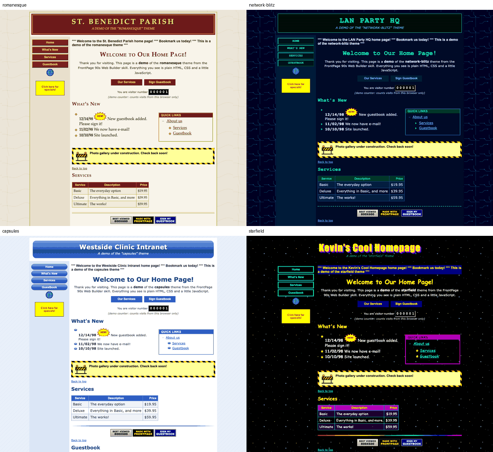

# FrontPage 90s Web Builder

[](https://skills.sh/jamarks/ms-frontpage-visual-skill)


**An agent skill that builds websites that look like they were made with Microsoft FrontPage 97/98/2000** —
themes, shared borders, beveled navigation bars, hit counters, marquees, guestbooks, WordArt and 88x31
badges — that still work offline, on phones and in every modern browser.

```bash
npx skills add jamarks/ms-frontpage-visual-skill
```



<sub>Six sites built by test agents that had only this skill: a GeoCities band page, a mechanic's
multi-page site, a printable family recipe site, an architect's Blueprint portfolio, a birthday
invitation with countdown, and a Portuguese school anniversary page.</sub>

---

## What you can ask for

> *"Make me a GeoCities-style fan page for my band with a guestbook and a hit counter."*
>
> *"Hazme la web de mi panadería como si la hubiera hecho mi sobrino con FrontPage 98."*
>
> *"Convert this landing page into a FrontPage 2000 corporate site with the Blueprint theme."*
>
> *"Una invitación de cumpleaños noventosa, de una sola página, con cuenta regresiva."*
>
> *"A fake 1999 company intranet with frames for a stage play."*

The agent picks a coherent theme, scaffolds the site with FrontPage-style shared borders and a
navigation bar, fills it with period components and bespoke pixel art, then runs QA — broken links,
offline assets, accessibility, phone layout, clipped text, print — before handing it over.

## Themes

Ten coherent themes, recreated from scratch in CSS + SVG as homages to FrontPage's bundled themes.




| Theme | Feel | Good for |
|---|---|---|
| `classic` | FP98 "no theme": gray desktop, navy masthead, gray bevel buttons | small businesses, schools, clubs |
| `blueprint` | drafting grid, navy ink, outlined caps | engineering, architecture, IT |
| `expedition` | khaki parchment, browns, Book Antiqua | travel, outdoors, family businesses |
| `industrial` | diamond plate, hazard stripes, Impact | mechanics, construction, hardware |
| `citrus-punch` | orange + lime on cream | cafés, kids, parties |
| `sumi-painting` | rice paper, ink-brush banner, red seal | restaurants, tea, poetry |
| `romanesque` | marble, burgundy + gold | law, churches, museums, weddings |
| `network-blitz` | midnight circuit board, neon green | hackers, LAN parties, sci-fi |
| `capsules` | glossy blue pill buttons (FP2000) | clinics, software, intranets |
| `starfield` | black stars, neon, Comic Sans, rainbow rule | GeoCities homepages, fan sites |

Demo pages for each theme: [`examples/themes/`](examples/themes/).

## Components

Every component FrontPage users reached for, rebuilt to work today:

| | | |
|---|---|---|
| Page Banner | Navigation Bar (current page highlighted) | Shared Borders (top / left / bottom) |
| Hover Buttons | Hit Counter (LED / odometer) | Marquee (left, right, alternate) |
| Banner Ad Manager (468x60 / 120x60) | Search Form (one page or whole site) | Feedback form + Confirmation page |
| Contact via WhatsApp / e-mail | Guest Book | Collapsible outline |
| Table of Contents | Timestamp | Countdown |
| Click-to-play "background MIDI" | WordArt titles | 88x31 badges |
| Under construction | Photo Gallery | Web ring |
| Frames (iframe-based) | Page transitions & DHTML fly-ins | Pixel-art clip art |

## Principles

- **Looks 1998, works today.** Table layouts and `<font>` tags on the outside; viewport meta, phone
  stacking, keyboard focus, `prefers-reduced-motion` and a print stylesheet on the inside.
- **Honest.** Counters say they count *this browser*. Guestbooks say they're local. Forms without a
  backend open WhatsApp or e-mail with the message ready, or show a confirmation page that says nothing
  was sent. No invented reviews, prices or e-mails for real businesses: placeholders are marked and
  reported back to you.
- **Self-contained.** No CDNs, web fonts or hotlinked GIFs. It opens by double-clicking `index.html`,
  and deploys to any static host.

## What's in the skill

```
skills/frontpage-90s-web-builder/
├── SKILL.md                     # the instructions the agent follows
├── assets/
│   ├── fp-kit.css, fp-kit.js    # every component; theme-neutral, zero dependencies
│   ├── themes/*.css             # the 10 themes
│   └── clipart/*.svg            # NEW!, HOT!, e-mail, construction, globe, arrow
├── references/
│   ├── components.md            # copy-paste markup for every component
│   └── themes-and-eras.md       # theme picker, FP97/98/2000/2002 differences, personas, period phrases
├── scripts/
│   ├── scaffold.py              # pages with theme + shared borders + nav (left, top or frames layout)
│   ├── check_site.py            # QA: links, offline, alt, motion, honesty, modern smells, TODOs, --source diff
│   ├── screenshot.py            # headless Chrome: desktop + true 390px phone, overflow & clipping, print PDF
│   ├── build_search_index.py    # whole-site search that works from file://
│   └── pixelart.py              # text grid → crisp pixel-art SVG
└── agents/openai.yaml           # metadata for Codex
```

The scripts are Python 3, standard library only. `screenshot.py` uses an installed Chrome, Chromium or Edge.

## Install

**Any agent, via [skills.sh](https://skills.sh)** (Claude Code, Codex, Cursor and others):

```bash
npx skills add jamarks/ms-frontpage-visual-skill
```

Add `-g` to install it for every project instead of the current one.

**Claude Code plugin marketplace:**

```
/plugin marketplace add jamarks/ms-frontpage-visual-skill
```

**Manually:** copy `skills/frontpage-90s-web-builder/` into your agent's skills folder (for Claude Code,
`~/.claude/skills/`). For Claude.ai, zip that folder and upload it under *Settings → Capabilities → Skills*.

## Try the scripts without an agent

```bash
cd skills/frontpage-90s-web-builder
python3 scripts/scaffold.py --list-themes
python3 scripts/scaffold.py /tmp/mysite --theme expedition --title "Trailhead Outfitters" --pages "index.html=Home,gear.html=Gear,contact.html=Contact"
python3 scripts/check_site.py /tmp/mysite
python3 scripts/screenshot.py /tmp/mysite --out /tmp/shots
```

## How it was tested

The skill began as a ChatGPT draft with generic "90s web" guidance and one starter page. It was rebuilt
around a real component kit and then tested over four rounds with 17 independent agent runs. Each agent
had only the skill to work from and got a realistic request, in English, Spanish or Portuguese:

- a mechanic's multi-page site, built with both the original and the new skill;
- a GeoCities band page;
- a SaaS landing page converted to FrontPage 2000;
- a frames intranet for a stage play;
- a birthday invitation;
- a printable family recipe site;
- an architect's portfolio;
- a résumé easter egg;
- a cumbia band site;
- a school anniversary page.

The agents' QA notes drove the fixes between rounds. Among them:

- marquees stretched the layout table;
- headless Chrome on macOS can't render narrower than 500px;
- print output came out blank;
- linked badges were unreadable;
- radio buttons garbled WhatsApp messages;
- an invitation's weekday didn't match its date.

## Español

Una *skill* para agentes (Claude Code, Codex, Cursor…) que arma sitios con la estética y los
componentes de **Microsoft FrontPage** de fines de los 90:

- themes, shared borders y botones biselados;
- contador de visitas, marquesina y libro de visitas;
- WordArt y badges 88x31.

El HTML resultante funciona hoy: se ve bien en el celular, anda sin internet y no miente. El contador
dice que es local, y los formularios sin servidor abren WhatsApp o el mail en vez de fingir que envían
algo. Para instalarla:

```bash
npx skills add jamarks/ms-frontpage-visual-skill
```

Después pedile a tu agente algo como *"haceme la web de mi taller como si la hubiera hecho mi sobrino
con FrontPage 98"*.

## License

MIT — see [LICENSE](LICENSE). FrontPage, Internet Explorer and WordArt are trademarks of Microsoft.
This project is an unaffiliated homage; the themes and clip art are original recreations.
